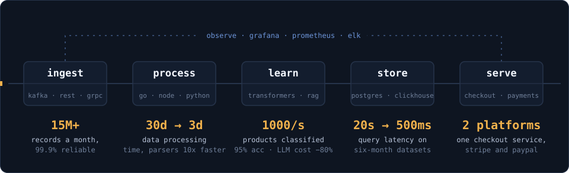
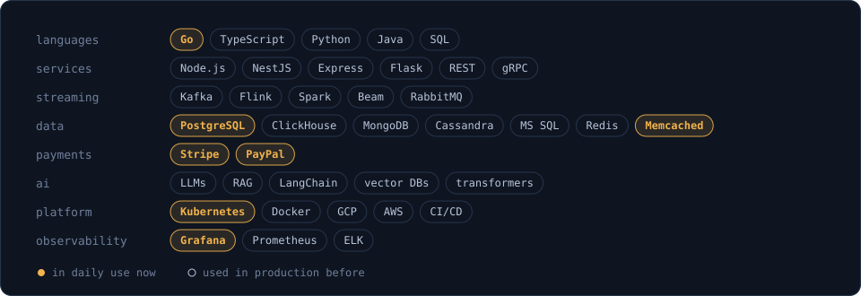

  

 

I design backend systems where data volume and money are both on the line. Five years in: streaming pipelines, analytical stores, ML-backed services, and now checkout and payments in Go.

  

 

  

 

Open to conversations about system design, database performance and payments infrastructure.
Off the clock: football and anime.

[LinkedIn](https://www.linkedin.com/in/naveen-devwhiz/)
